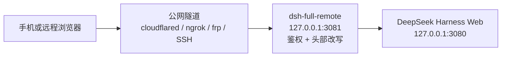

# dsh-full-remote

[](https://github.com/awesome-dsh-plugin/awesome-dsh-plugin)
[](https://github.com/JUANWANG-BUAA/dsh-full-remote/releases/latest)
[](https://github.com/JUANWANG-BUAA/dsh-full-remote/actions)
[](./LICENSE)
[](https://github.com/JUANWANG-BUAA/dsh-full-remote/stargazers)
[](https://github.com/JUANWANG-BUAA/dsh-full-remote/commits/main)
[](./package.json)
[](https://github.com/deepseek-ai/deepseek-harness)
[](https://github.com/JUANWANG-BUAA/dsh-full-remote/pulls)

**已收录进 [awesome-dsh-plugin](https://github.com/awesome-dsh-plugin/awesome-dsh-plugin)** · DeepSeek Harness 插件

**当前版本：[v0.5.0](https://github.com/JUANWANG-BUAA/dsh-full-remote/releases/tag/v0.5.0)** · 通过 GitHub Releases 分发

[English](./README.md) | **中文**

`dsh-full-remote` 是 [DeepSeek Harness](https://github.com/deepseek-ai/deepseek-harness) 的一个插件：它在 Harness Web 服务前放置一层带鉴权的反向代理，使 Web 界面可以通过公网隧道或局域网设备访问，同时保持设置、凭据、目录浏览等特权接口可用。

## 0.5.0 新增

- 跨会话可选择式「**任务控制台**」：审批、问答、计划评审和会话导航；当前页面内保留草稿、断线禁提交、不自动重放写操作。
- Brotli/gzip 协商、设备隔离的已编码静态缓存、自有上游连接池、按真实活动识别失效，以及后台暂停、同类慢请求不重叠的轮询。
- 保持 DeepSeek Harness **0.2.1-rc.2** 兼容性，以及既有鉴权与仅限回环的代理管理边界。

### 实测收益与代价

对比**已经使用 gzip 的旧版**，15 个配对本机 HTTP 轮次；时间是请求累计耗时，**不是 LCP 或真实手机页面加载时间**。

| 场景 | 基线 → 0.5.0 候选实现 | 含义 |
|---|---|---|
| 冷 HTML + 4 个入口资源 | 42.08 → 25.61 ms；415,637 → 415,534 B | HTTP 耗时 −39.1%，主体字节仅少 **0.025%** |
| 40 次热静态请求 | 424.68 → 28.15 ms；回源 40 → 0 次 | HTTP 耗时 −93.4%，不是下行流量减少 100% |
| 40 次条件请求 | 主体 0 → 0 B；头部 6,360 → 9,800 B | 两版原本都返回 304；新版免回源但增加元数据 |
| 10 次合成动态 JSON 请求 | 8.82 → 10.25 ms | 本机**慢 16.2%**，没有缓存 API |
| 真实 React 组件，模拟 60 秒 | 隐藏 RPC 50 → 0；可见慢 RPC 48 → 20 | 正常可见仍为 50 次，不是耗电实测 |

完整方法、同编码对照、局限与复现：[中文报告](./docs/performance-benchmark.zh.md) · [English benchmark](./docs/performance-benchmark.md)。

## 60 秒快速开始

```sh
curl -fLO https://github.com/JUANWANG-BUAA/dsh-full-remote/releases/download/v0.5.0/dsh-full-remote-0.5.0.tgz
dsh plugin --profile web add ./dsh-full-remote-0.5.0.tgz
dsh --profile web
```

在 **设置 → 反向代理** 中点击「启动代理」，再点击「启动 Cloudflare
快速隧道」，用手机扫描面板生成的二维码。邀请链接只可使用一次，且不包含长期访问令牌。
如果使用受控网络，也可以把现有的 SSH、frp、ngrok、Tailscale 或 cloudflared
隧道指向面板显示的代理地址。

快速隧道是可选的临时通道，不等同于正式运维的公网部署；对外暴露前请先阅读[安全模型](#安全模型)，组合其他插件时请查看[兼容性说明](./docs/compatibility.md)。

| 桌面控制面板 | 手机工作区 |
|---|---|
|  |  |

| 任务控制台待办 | 控制台问答表单 |
|---|---|
|  |  |

## 问题

DeepSeek Harness 的 Web 服务只绑定回环地址，且仅当请求的 `Host`、`Origin` 头指向回环地址时才放行特权接口。经通用隧道访问时，这两个头携带的是公网域名，无法通过信任校验。页面可以加载，但以下接口返回 403：

- `settings.*`
- `credentials.*`
- `host.listDirectory`

| 已有做法 | 结果 |
|---|---|
| 通用隧道（SSH 端口转发、Caddy、绑定 `0.0.0.0`） | 页面可加载；`settings.*` / `credentials.*` / `host.listDirectory` 返回 403 |
| 仅限局域网的插件，无鉴权 | 局域网内可用，不适合公网暴露 |
| 只有密码校验，不改写请求头 | 请求通过了鉴权，但特权接口仍然被拦截 |

## 解决方案

插件在隧道与 Harness Web 服务之间插入一层反向代理：

- 转发前将 `Host`、`Origin` 改写为 `127.0.0.1`，使特权接口通过 Harness 的信任校验；
- 任何请求都须先通过访问令牌或设备会话校验；
- 转发 HTTP、SSE、WebSocket 流量；符合条件的可压缩 HTTP 响应协商 Brotli/gzip（SSE / WebSocket 不压）；
- 提供设置页（**设置 → 反向代理**），用于启停代理、修改监听地址、轮换令牌、管理设备会话。

改写使 Harness 原本对远程客户端的信任校验失效，因此插件提供自己的访问控制层作为替代，见[安全模型](#安全模型)。

插件可以一键启动临时 Cloudflare 快速隧道；也支持把受控的 cloudflared、ngrok、frp、SSH、Tailscale 等现有隧道指向插件发布的本地地址。

## 工作原理



1. 远程浏览器连接公网隧道，流量转发到插件的监听地址（默认 `127.0.0.1:3081`）。
2. 请求只有携带访问令牌、有效的一次性邀请或已有的设备会话才会被接受；未通过鉴权的请求不会到达后端。
3. 代理将 `Host`/`Origin` 改写为回环地址，移除不可信头部，再转发到 `127.0.0.1:3080` 上的 Harness Web 服务。符合条件的可压缩 HTTP 响应（HTML/JS/CSS/JSON/SVG，≥1 KB）可协商 Brotli/gzip；SSE 与 WebSocket 不压。严格准入的带 hash `/assets/*` 使用 private immutable 浏览器缓存和有界设备隔离服务端 variant；HTML/API 不进入该静态缓存。详见 [HTTP 传输](./docs/http-gzip.zh.md)与[性能报告](./docs/performance-benchmark.zh.md)。

## 功能

### 特权接口

- `settings.describe` / `update` / `replace` / `mutate`
- `credentials.describe` / `set` / `unset`
- `host.listDirectory` / `pickDirectory` / `openPath`
- `agentPreset.*`、`llm.discoverModels`

### 访问控制

- 192 位访问令牌，状态文件权限 `0600`，在本地面板查看与轮换
- 按设备会话：每次登录生成独立的设备凭据，持久化时只保存其哈希；可在面板中重命名或撤销设备，并查看每台设备的来源 IP（登录时与最近活跃）
- 可选首访审批：新设备停留在等待页，直至本机批准
- 手机邀请：二维码或一次性链接（单次有效、15 分钟过期）。同 IP 60 秒内的浏览器自动重试会沿用同一台设备会话，避免隧道抖动丢响应时把手机卡进令牌页，也不会在设备列表里多出一条。链接中不含长期令牌
- 登录失败计入固定延时，并按 IP 累计锁定
- 可选 CIDR 白名单，限制远程 IP
- 可选 `trustForwardedFor`：在可信本地隧道后使用真实客户端 IP 进行 CIDR / 限流 / 审计；只有另行开启 `trustCloudflareConnectingIp` 才会读取 Cloudflare 的 `CF-Connecting-IP`，否则取 `X-Forwarded-For` 最右值；回环或非法的转发值一律不信任

### 一键公网隧道（Cloudflare 快速隧道）

- 面板内一键启动 cloudflared 快速隧道（免费、免账号），自动给出 `https://…trycloudflare.com` 地址，免公网 IP、免端口映射
- 二进制三级获取：`cloudflaredPath` → PATH 探测 → 钉版本（2026.8.2）+ 内嵌 SHA256 校验的按需下载缓存；校验失败即丢弃
- 隧道在线期间转发头信任动态生效（限流 / CIDR / 审计按真实客户端 IP），隧道关闭立即还原；隧道指向代理监听端口，令牌门 / 审批 / 审计全部照旧生效
- 邀请自动使用隧道地址：开隧道 → 生成邀请 → 手机扫码直入（面板显示且可手动覆盖 Origin）
- 与本地 TLS 互斥（Cloudflare 边缘已提供 HTTPS）；快速隧道地址每次启动随机变化，定位是临时分享 / 救急

### 设备主页（可选落点）

- 登录页第二个按钮「设备主页」进入 `/_dsh_reverse_proxy/home`：查看本设备信息（名称 / 登录 IP / 登录时间 / 会话到期 / 安全状态）
- 给自己设备改名（主人审批列表里看到「小王的 iPhone」而非「Safari on iOS」）、自助登出（只吊销本设备会话）
- 登录默认落点仍为 `/`，原有流程不变

### 运维

- 栅栏自检：使用与代理相同的 Host/Origin 改写探测 `settings.describe`
- 结构化 JSONL 审计日志（登录、审批、撤销、令牌轮换、启动、停止、WebSocket 打开/拒绝），并支持在面板内查看最近事件与导出 JSON；超过 8 MB 自动轮转，保留上一代
- 监听地址可在运行时修改，绑定失败自动回滚
- 可选本地 TLS（`tlsCertFile` / `tlsKeyFile`）
- 健康检查接口 `/_dsh_reverse_proxy/healthz`
- WebSocket 升级限流：同一远程 IP 反复升级失败后会进入锁定
- 请求体大小在流层面受限；剥离逐跳与可伪造头部；清除上游 `set-cookie`
- 对可压 HTTP 按客户端 q 值协商 Brotli（quality 4）/gzip；遵守 no-transform，跳过 SSE、WebSocket、Range、已编码和过小响应。
- 严格准入的 hashed `/assets/*` 使用浏览器 private immutable 与设备隔离的内存 variant LRU（8 MiB / 128 项 / 最多 5 分钟）；命中支持 ETag 304，认证/CIDR 始终先检查；服务端静态缓存排除 API、HTML、Set-Cookie 或未知 Vary 响应，浏览器缓存仍遵从上游策略。
- 自有 upstream keep-alive 池减少重复连接，真实流量维持设备活跃但不延长绝对 TTL；撤销及静默失效会关闭流两端。后台暂停轮询、恢复合并刷新，减少无意义数据请求。
- 关闭压缩／静态缓存：`compressResponses: false` / `cacheHashedAssets: false`。协议边界见 [HTTP 传输](./docs/http-gzip.zh.md)，本轮收益与退化见[性能报告](./docs/performance-benchmark.zh.md)。

### 移动端

- 通过隧道域名打开设置页时，改动正常持久化；**设置 → 模型** 能加载提供方目录（Harness `0.1.0-rc.8` 起依赖页面引导在官方 `create()` 之后仍钉住 `isLoopback`），其中包含 `DeepSeek-V4-Flash-Vision-Exp`
- 「添加工作区」使用应用内目录浏览，不会在宿主机显示器上弹出系统对话框
- 手机窄屏（≤720 CSS px）或远程主机名页面会显示可收起的「任务控制台」入口：手机展开为全宽底部面板，宽屏展开为右侧紧凑面板，配色和明暗主题跟随 Harness。
- 「待我处理」按会话列出当前最高优先级的工具审批、问答和计划评审；可选择任意待办、返回列表或稍后处理，不再强制只看第一条。切换/收起时保留当前页面内的答案草稿；刷新、卸载或会话服务重建会清空草稿。
- 「会话」展示官方列表中的运行状态、待查看的停止动态与会话入口，并标记本次页面最近打开的会话；未知状态不会标成已完成，列表首次加载也不会误报为空。
- 连接断开时禁止提交；恢复连接或回到前台会请求刷新。通道连通不等于会话已同步，界面始终注明是最近已知状态。已发送操作保持锁定并显示确认中/结果不确定，不自动重发审批或消息；必要时刷新核对或进入原会话处理。
- 自定义答案可换行，`Shift+Enter` 插入换行。控制台复用官方交互方法和会话导航，不替代聊天、不开放本机代理管理接口；尚不包含 PWA、后台推送、跨刷新草稿或分级授权。
- 远程粘贴/拖入图片走同一条已认证的 `/api`（`deepseek-v4-flash-vision-exp` 等图像路由）。默认请求体上限 160 MiB，与 Harness `/api` 桥一致；点阵图响应不做 gzip
- 想要手机友好的布局（会话区全宽、目录改抽屉、弹窗适配），建议搭配移动端布局插件使用，例如 [dsh-web-mobile](https://github.com/mexiaosqwq/dsh-web-mobile)

实现范围、已验证的尺寸与复现命令见 [控制台验证说明](./docs/cockpit-validation.md)。

## 环境要求

- Node.js `^22.19.0 || >=24`
- DeepSeek Harness 的 **web** profile（**0.2**，即 npm dist-tag `next` 的 `0.2.1-rc.2`，与 DeepSeek Harness 桌面 App 0.2.1 同版）。插件依赖 `webServer`、Host Connection 服务，以及 0.2 的客户端服务（`uiSession`、`uiWorkspace`、`ui-approval`、`ui-user-questions`），不适用于 headless profile。不再支持 0.1.x：0.2 客户端移除了 `@deepseek-ai/dsh-client-runtime`，待处理交互改由 `uiSession` 注册表发布。0.2.1 新增了 Remote 访问快照（`dsh-api-remote-access`），它不会收紧本代理服务的浏览器身份，见[兼容性](./docs/compatibility.md#deepseek-harness-021)。

## 安装

```sh
curl -fLO https://github.com/JUANWANG-BUAA/dsh-full-remote/releases/download/v0.5.0/dsh-full-remote-0.5.0.tgz
curl -fLO https://github.com/JUANWANG-BUAA/dsh-full-remote/releases/download/v0.5.0/SHA256SUMS
shasum -a 256 -c SHA256SUMS
dsh plugin --profile web add ./dsh-full-remote-0.5.0.tgz
dsh --profile web
```

当前版本为 **v0.5.0**。npm 发布与 GitHub Release 相互独立，目前 registry
版本落后；安装或升级本版本时请使用上面的 GitHub 附件。

1. 打开 `http://127.0.0.1:3080`。
2. 打开 **设置 → 反向代理**（左侧导航最后一项）。
3. 点击 **启动代理**，复制本地目标地址。
4. 将隧道指向该地址：

```sh
# 仅为示例，插件不会执行这些命令
cloudflared tunnel --url http://127.0.0.1:3081
ngrok http 3081
```

同一网络内的设备无需隧道，把监听地址设为局域网 IP 即可。

本包原名 `dsh-reverse-proxy`，现已改名为 `dsh-full-remote`。

## 使用

### 界面语言

插件面板提供 **Language / 语言** 选择器：**自动**、**English**、**中文**。自动模式优先跟随 Harness 语言，语言服务不可用时跟随浏览器（非中文浏览器使用英文）。手动选择按浏览器和访问地址保存，并同步应用于远程确认弹层。登录页、等待审批页与设备主页仍跟随浏览器的 HTTP 语言头。

### 启动与停止

在设置页点击 **启动代理** 开始监听，点击 **停止代理** 停止。

### 监听地址

| 绑定 | 用途 |
|---|---|
| `127.0.0.1`（默认） | 隧道与 Harness 在同一台机器 |
| `192.168.x.x` | 同一网络内的设备直连，不走隧道 |
| `0.0.0.0` / `::` | 绑定全部网卡。这不是要打开的地址，面板会另外给出可达地址。 |

监听地址可在运行时修改，并在重启后保持。新地址绑定失败时，代理自动回滚到上一个可用地址。

面板里可复制的 **隧道目标**（以及列出的其他可达地址）才是远程端要打开的 URL。绑定 `0.0.0.0` 只表示监听，不是可打开的地址。

`backendHost` 是代理连接的后端地址，不是监听地址，保持 `127.0.0.1`。

### 手机邀请

二维码是一次性登录 URL。**公网 / 可达 Origin** 填的是**扫码设备**能访问的地址：隧道的 `https://…`，或面板给出的局域网 URL。仅当上方隧道目标已经是该地址时才可留空。

不要把 `127.0.0.1` 写入 Origin。那是运行 Harness 的机器；手机扫码后会访问手机自己的回环地址，连不上本机代理。

然后点击 **生成邀请**。扫码或打开链接后，登录页会自动提交。链接单次有效、15 分钟过期；同 IP 60 秒内的自动重试会沿用同一台设备会话。不含长期令牌。只有代理运行时才能生成邀请。

### 升级

下载当前 GitHub Release，并把 tarball 添加到现有 web profile：

```sh
curl -fLO https://github.com/JUANWANG-BUAA/dsh-full-remote/releases/download/v0.5.0/dsh-full-remote-0.5.0.tgz
dsh plugin --profile web add ./dsh-full-remote-0.5.0.tgz
```

然后重启 `dsh web`。这会把 registry 或旧 tarball 安装的版本替换为
**v0.5.0**。

## 截图

截图画廊保留在 GitHub 仓库中；发布包只携带运行所需文件并链接回这里，
因此安装包更小。

### 桌面端

完整设置页一图览：运行状态与栅栏自检、发布地址、推荐用法、隧道目标、
一键快速隧道、一次性邀请二维码、访问令牌、带来源 IP 的已连接设备
（行内改名），以及审计查看器。


| 一次性手机邀请（二维码） | 行内改名的已连接设备 |
|---|---|
|  |  |

### 移动端

| 手机登录页 | 移动控制面板 |
|---|---|
|  |  |

### 远程确认

通过「任务控制台」入口选择跨会话的选项确认、工具审批或计划评审，无需回到宿主机显示器。下图为 0.5.0 可选择式控制台的已留存 fixture 截图；真实宿主验收的来源与局限见[控制台验证](./docs/cockpit-validation.md)。

| 任务控制台待办 | 控制台问答表单 |
|---|---|
|  |  |

### 门面页

令牌登录（带可选的 **设备主页** 按钮）、设备主页本身，以及首次访问的审批等待页。

| 设备主页 | 等待审批 |
|---|---|
|  |  |

## 常用配置

```yaml
- id: reverse-proxy
  name: dsh-full-remote
  config:
    listenHost: 127.0.0.1
    listenPort: 3081
    approvalMode: false          # true：新设备需要本机批准
    allowedCidrs: []             # 例如 ["192.168.1.0/24"]；留空 = 登录后不限 IP
    trustForwardedFor: false     # true：信任可信本地隧道传来的 X-Forwarded-For 最右值
    trustCloudflareConnectingIp: false # 仅在 Cloudflare 边缘明确可信时开启
    upgradeMaxAttempts: 10       # WebSocket 升级失败多少次后锁定
    upgradeLockoutSeconds: 300   # WebSocket 升级频繁失败的锁定秒数
    headersTimeoutMs: 15000      # 请求头超时
    requestTimeoutMs: 300000     # 完整请求超时（含 body）；覆盖远程视觉上传
    upstreamTimeoutMs: 15000     # TCP 连接 + POST body 结束后等首字节；SSE GET 不用这项
    commandTimeoutMs: 300000     # 主机命令（/compact 等）的首字节等待；覆盖 /api/commands/execute 与以 "/" 开头的 session.prompt
    maxRequestBytes: 167772160   # 160 MiB，与 Harness /api 图像信封一致
    sessionIdleSeconds: 0        # 0 = 关闭；否则按空闲秒数过期
    auditLog: true
    allowTokenRead: false        # 更安全的默认值；仅本机工具需要重读时开启
    cloudflaredPath: ""          # 可选：一键隧道用的 cloudflared 路径
    tlsCertFile: ""              # 可选本地 HTTPS
    tlsKeyFile: ""
    compressResponses: true      # 协商 br/gzip；跳过 SSE/WS/Range/字体/栅栏页
    cacheHashedAssets: true      # 私有浏览器缓存 + 有界设备隔离静态 variant 缓存
```

完整选项、默认值与校验规则定义在包内 `Config` schema（`src/config.ts`）及
`src/config-validation.ts`；发布包不包含源码目录。

两点说明：

- 安装插件会钉住应用内目录选择器，使手机可以添加工作区。默认禁用官方自适应选择器，并在组合里还没有官方 browse 行时于运行时创建它；只有明确需要宿主原生选择器、且不需要远程目录浏览时，才在启动前设置 `DSH_FULL_REMOTE_USE_NATIVE_PICKER=1`。
- `backendHost` 必须是回环地址，通配地址或非回环地址在加载时会被拒绝。

## 安全模型

Host/Origin 改写恢复了特权接口，同时也使 Harness 对远程客户端原有的保护失效。插件提供的访问控制层包括：

- 192 位访问令牌，本地存储，文件权限 `0600`；
- 按设备的 `HttpOnly`、`SameSite=Strict` 会话 Cookie，携带按设备秘密，存储时只保存其哈希；
- 登录失败计入固定延时，并按 IP 返回 `429` 锁定；
- 控制接口（`/dsh-reverse-proxy/*`）仅限回环地址访问，需要控制头，且永远不会被公网代理转发；
- 剥离可伪造的转发头与逐跳头，代理自身的 Cookie 不会到达后端；
- 可选 `trustForwardedFor`：开启后仅信任回环对端传来的转发头，用于 CIDR / 限流 / 审计，使本地隧道能识别真实客户端 IP。只有额外开启 `trustCloudflareConnectingIp` 才读取 Cloudflare 的 `CF-Connecting-IP`，否则取 `X-Forwarded-For` 最右值；回环或非法的转发值一律不信任。局域网直连请保持关闭。

访问令牌须按机密保管。公网侧应终止 TLS。局域网直连可配置 `tlsCertFile` / `tlsKeyFile`（例如用 [mkcert](https://github.com/FiloSottile/mkcert) 生成）。

**公网暴露清单。** 任何持有访问令牌的人都等于掌握了整台 Harness（包括凭据与设置）。凡是能被公网访问到的入口：

- 请开启 `approvalMode: true`：新设备将保持待审批状态，直到你在本机控制面批准（快速隧道在线且未开审批时，面板会显示警告）；
- 建议配合 `allowedCidrs` 把入口限定到已知网络；
- 保持 `auditLog: true`（默认开启），并在分享出去的邀请失去用途后及时轮换令牌。

## 局限

- 控制操作（启动、停止、查看令牌、修改监听地址）仅可在本机 Harness 窗口执行，隧道地址下无效。
- 远程页面上的设置持久化依赖临时的信任注入，待 Harness 提供正式的部署信任字段后可以移除。Harness `0.1.0-rc.8` 起的模块加载器会在 `create()` 时覆盖 `load`，本插件的页面引导必须在那之后继续包装，否则远程 **设置 → 模型** 会报 `settings are unavailable in this browser`。手机上的「在宿主机打开」作用于运行 Harness 的机器。
- `allowTokenRead` 默认 `false`。显式开启时，`GET /token` 会通过回环 HTTP 提供，任何能发送控制头的本机进程均可读取；轮换令牌始终会返回新令牌。
- 默认情况下，运行在本机的隧道会让所有远程客户端在代理看来都是 `127.0.0.1`。因此 `allowedCidrs` 与按 IP 登录锁定只对“隧道整体”生效；如需按真实客户端 IP 生效，请在可信本地边缘后设置 `trustForwardedFor: true`。
- 插件以自身的访问控制层替代 Harness 的远程信任校验，该层若存在缺陷，影响严重。若 Harness 未来提供官方远程访问能力，应重新评估本插件的定位。
- 一键快速隧道：URL 每次启动随机变化（旧邀请与登录失效）、官方定位是临时/测试用途，非 HTML 大流量内容受 Cloudflare 条款限制；首次使用需按需下载 cloudflared（18–52 MB，取决于平台），Windows ARM64 没有官方构建（可自行安装后填 `cloudflaredPath`）。日常稳定入口仍建议自备 frp / ngrok / 命名隧道。
- 代理侧 Brotli/gzip 可帮助局域网与 SSH/frp；Cloudflare 快速隧道边缘可能已压缩，不能假设仍有相同字节收益，但命中的代理静态缓存仍可减少上游工作。对话 WebSocket 流、SSE 与插件自己的登录/等待/主页不走该 HTTP 压缩路径。完整约定：[HTTP 传输](./docs/http-gzip.zh.md)；实测收益与代价：[性能报告](./docs/performance-benchmark.zh.md)。

## 开发

### 从源码构建

```sh
pnpm pack
dsh plugin --profile web add ./dsh-full-remote-0.5.0.tgz
```

git 安装会执行 `prepare` 构建，pnpm ≥ 10 需要放行：

```yaml
allowBuilds:
  dsh-full-remote: true
```

### 检查与 CI

```sh
pnpm install
pnpm run check:ci
```

`check:ci` 包含 lint、类型检查、单元与客户端测试、构建；CI 另含一次针对真实 Harness 组合的 `dsh plugin add` 冒烟测试。`.github/workflows/canary.yml` 每周针对 harness 默认分支 tip 运行一次冒烟测试。

本机控制面 API 位于 `/dsh-reverse-proxy/*`，不会被公网代理转发。设置页是预期入口，一般无需直接调用这些接口。例如可用 `GET /dsh-reverse-proxy/audit?limit=50&event=login.ok` 在本机读取最近的审计事件。

## 贡献 · 安全 · 许可证

- [CONTRIBUTING.md](./CONTRIBUTING.md)
- [SECURITY.md](./SECURITY.md)
- [MIT](./LICENSE) © 2026 [JUANWANG-BUAA](https://github.com/JUANWANG-BUAA)
